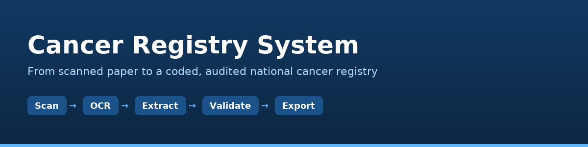

<div dir="rtl" align="right">

# نظام سجل السرطان — Cancer Registry System



**نظام متكامل لتبليغ حالات السرطان وترميزها وتدقيقها وأرشفتها**، مبني لمكتب سجل
السرطان — المعهد القومي للأورام، صبراتة، ليبيا.

> يحوّل التقارير الورقية الممسوحة ضوئياً إلى سجل وطني مُرمَّز وفق **ICD-O-3**
> و**TNM**، مُدقَّق بنحو **40 قاعدة جودة**، ومُصدَّر إلى **Excel** بنفس قالب
> السجل الوطني — من واجهة متصفح عربية بالكامل، أو من سطر الأوامر على مجلد كامل،
> أو من داخل **أودو 17/18**.

---

## 1) الفكرة باختصار

لديك **قاموس حقول واحد** (`crcore/dictionary.py`) — 85 حقلاً في 7 مجموعات — ومنه
تُبنى تلقائياً:

| الوجه | ماذا يعطيك | متى تستخدمه |
|---|---|---|
| **الأداة المستقلة** (واجهة متصفح + سطر أوامر) | تشغيل فوري بلا خادم ولا قاعدة بيانات؛ يعالج مجلداً كاملاً من الملفات بضغطة واحدة | **لتصفية المتأخرات الآن** — هذا ما ينجز عملك اليومي |
| **وحدة أودو** `odoo/cancer_registry/` | أرشفة طويلة الأمد، صلاحيات، متابعة، لوحات تحليلية، تكامل مع بقية أنظمة المؤسسة | عندما يكون لدى المؤسسة خادم أودو |

الاثنان يستخدمان **نفس النواة** (`crcore/`) ونفس القاموس ونفس محرك الجودة ونفس
قالب Excel — فلا يوجد «نسخة ثانية» تتباعد عن الأولى أبداً.

**دورة العمل في الواجهتين واحدة:**

```
ورق ممسوح ضوئياً ──▶ رفع المستند ──▶ القراءة الآلية (OCR) ──▶ استخراج الحقول
        ──▶ فحص جودة البيانات ──▶ المعاينة والمراجعة ──▶ الاعتماد ──▶ تصدير Excel
```

---

## 2) التثبيت — الأداة المستقلة

### 2.1 المتطلبات الأساسية (كل الأنظمة)

* **Python 3.9 أو أحدث.**
* حزم بايثون (تُثبَّت مرة واحدة):

  ```bash
  pip install -r requirements.txt
  ```

  وهي: `openpyxl` (Excel)، `pypdf` + `pdfminer.six` (قراءة PDF)، `flask`
  (واجهة المتصفح)، `requests` (اختياري — لخدمة Azure).

> على أنظمة حديثة ترفض التثبيت النظامي (رسالة *externally-managed-environment*)
> استخدم بيئة افتراضية:
> ```bash
> python3 -m venv .venv && source .venv/bin/activate   # Linux/macOS
> python -m venv .venv && .venv\Scripts\activate       # Windows
> pip install -r requirements.txt
> ```

### 2.2 محرك القراءة الضوئية OCR (اختياري لكنه مهم للصور الممسوحة)

بدون OCR تعمل الأداة **بكامل طاقتها** على: ملفات PDF النصية، الملفات النصية،
الإدخال اليدوي، ولصق النص. أما **الصور الممسوحة ضوئياً** (PNG/JPG/TIFF) فتحتاج
**Tesseract** مع حزمة اللغة العربية.

#### ويندوز

1. نزّل مثبّت Tesseract من مشروع UB-Mannheim:
   <https://github.com/UB-Mannheim/tesseract/wiki>
   (ملف `tesseract-ocr-w64-setup-…exe`) وثبّته في المسار الافتراضي
   `C:\Program Files\Tesseract-OCR`.
2. **أثناء التثبيت** اختر في شاشة *Additional script data* لغة **Arabic (`ara`)**
   والإنجليزية (`eng`). إن لم تفعل، ثبّتها لاحقاً: نزّل
   `ara.traineddata` و`eng.traineddata` من
   <https://github.com/tesseract-ocr/tessdata> وضعهما في
   `C:\Program Files\Tesseract-OCR\tessdata`.
3. أضف مسار البرنامج إلى متغير البيئة `PATH`:
   *لوحة التحكم ← النظام ← إعدادات النظام المتقدمة ← متغيرات البيئة ← Path ←
   جديد ← `C:\Program Files\Tesseract-OCR`*.
4. حزمة **Poppler** (لتحويل صفحات PDF إلى صور): نزّلها من
   <https://github.com/oschwartz10612/poppler-windows/releases> وفكّها ثم أضف
   مجلد `Library\bin` إلى `PATH`.
5. تحقق:
   ```powershell
   tesseract --version
   tesseract --list-langs        # يجب أن يظهر ara و eng
   pdftoppm -v
   ```

#### ديبيان / أوبنتو / لينكس مينت

```bash
sudo apt update
sudo apt install -y tesseract-ocr tesseract-ocr-ara poppler-utils \
                    python3-pip python3-venv
```

#### فيدورا

```bash
sudo dnf install -y tesseract tesseract-langpack-ara poppler-utils python3-pip
```

#### ماك

```bash
brew install tesseract tesseract-lang poppler
```

> **ملاحظة خادم أودو:** إن كنت ستشغّل الوحدة داخل أودو على خادم لينكس، نفّذ
> نفس أمر `apt`/`dnf` أعلاه على الخادم نفسه، ثم أعد تشغيل خدمة أودو حتى يلتقط
> المسار الجديد.

### 2.3 التشغيل

```bash
python3 run.py
```

يفتح المتصفح تلقائياً على <http://127.0.0.1:8765>. خيارات مفيدة:

```bash
python3 run.py --port 9000          # منفذ مختلف
python3 run.py --no-browser         # بدون فتح المتصفح
python3 run.py --demo               # يحمّل 5 حالات تجريبية للتعرّف على النظام
python3 run.py --storage D:\registry   # مجلد تخزين مختلف (Windows)
```

عند الإقلاع تطبع الأداة **لوحة حالة المحركات** وتخبرك بصراحة ما هو متاح وما هو
ناقص وكيف تُثبّته — لا مفاجآت.

---

## 3) الأداة المستقلة — دليل الاستخدام

### 3.1 واجهة المتصفح

شريط الأدوات العلوي هو الأزرار الستة المطلوبة في مواصفة المكتب، بنفس الترتيب:

| الزر | ماذا يفعل |
|---|---|
| **① رفع مستند ممسوح ضوئياً / PDF** | يُرفق الملف (سحب وإفلات أو اختيار)، يحسب بصمة **SHA-256**، يمنع تخزين نفس الملف مرتين، ويؤرشِفه في `storage/documents/<سنة>/<رقم السجل>/`. |
| **② التلخيص والاستخراج الذكي** | يقرأ المستند (Tesseract ← نص PDF المدمج ← Azure AI ← يدوي) ثم يستخرج الحقول تلقائياً: الأسماء، الرقم الوطني، التواريخ، الموقع الأولي ورمزه، الفحص النسيجي، TNM والمرحلة، العلاج، والحالة الحيوية. يعرض **دليلاً** لكل حقل مستخرج (النص الذي استُخرج منه) ونسبة ثقة. **لا يكتب فوق قيمة أدخلتها يدوياً.** |
| **③ فحص جودة البيانات** | نحو 40 قاعدة (انظر §6): اكتمال الحقول الإلزامية، صحة صيغة ICD-O-3، اشتقاق TNM والمرحلة، تناقض التواريخ والجرعات، توافق الجنس مع الموقع، وكشف **السجلات المكررة** عبر كل السجل. يعرض درجة من 100 مع كل مشكلة وإصلاحها المقترح ومرجعها المعياري. |
| **④ المعاينة** | عرض **جنباً إلى جنب**: المستند الأصلي (PDF/صورة) في جهة، والحقول المستخرجة مع إبراز مواضعها في النص في الجهة الأخرى — للمراجعة البشرية قبل الاعتماد. |
| **⑤ مكان الملف المخزن** | يفتح نافذة تعرض: مسار الأرشيف الفعلي على القرص، بصمة الملف، سجل التدقيق، وشجرة مجلد التخزين، وموضع الملف في نظام المستندات إن كان متاحاً. |
| **⑥ حفظ كـ / تصدير** | ملف Excel من **6 أوراق** مطابق لقالب السجل الوطني (§5). |

وإلى جانبها: **لصق النص يدوياً** (عند رداءة المسح)، **اعتماد السجل**، و**ملخص
للطباعة**.

### 3.2 سطر الأوامر — لتصفية المتأخرات دفعة واحدة

ضع كل ملفاتك الممسوحة في مجلد (أي تسمية، أي ترتيب، PDF أو صور أو نصوص) ثم:

```bash
python3 cli.py process "D:\مسح_2026"
```

* يعالج كل ملف، يمنحه رقم سجل تسلسلياً (`CR2026/0001`، `CR2026/0002`، …)،
  ويستخرج الحقول ويفحص الجودة ويحفظ.
* في النهاية يطبع **جدول ملخص**: المحرك المستخدم لكل ملف، عدد الحقول، ودرجة
  الجودة — فتعرف فوراً أي ملف يحتاج مراجعة بشرية.
* ملفات بها أخطاء جودة **لا تُهمَل**: تُحفظ بوضع «به أخطاء» وتظهر في قائمة
  المراجعة.

خيارات شائعة:

```bash
python3 cli.py process المجلد/ -v                 # تفصيل كل حقل مستخرج ودليله
python3 cli.py process المجلد/ --excel            # يصدر Excel فوراً بعد المعالجة
python3 cli.py process المجلد/ --engine tesseract # فرض محرك معين
python3 cli.py process المجلد/ --facility "مستشفى صبراتة التعليمي"
```

بقية الأوامر:

```bash
python3 cli.py qc                                  # إعادة فحص كل السجلات المحفوظة
python3 cli.py qc --only-errors                    # التي بها أخطاء فقط
python3 cli.py export --out سجل_2026.xlsx          # تصدير كل السجلات
python3 cli.py export --only-validated             # المعتمدة فقط
python3 cli.py extract ملف.pdf --show              # استخراج بلا حفظ (للتجربة)
python3 cli.py status                              # حالة المحركات والإحصاءات
python3 cli.py dictionary                          # طباعة قاموس الحقول كاملاً
python3 cli.py dictionary --group C                # مجموعة واحدة
```

### 3.3 أين تُحفظ بياناتي؟

في مجلد `storage/` داخل المشروع (أو المسار الذي تحدده بـ `--storage` أو بمتغير
البيئة `CR_STORAGE_DIR`):

```
storage/
├── cases/          سجلات JSON كاملة (الحقول + العلاج + المستندات + نتائج الجودة)
├── documents/      الملفات الأصلية:  documents/<سنة التشخيص>/<رقم السجل>/<بصمة>_<اسم>
├── exports/        ملفات Excel المُصدَّرة
├── index.json      فهرس سريع للبحث وكشف التكرار
└── audit.jsonl     سجل تدقيق: من فعل ماذا ومتى (رفع، استخراج، تعديل، تصدير…)
```

كل شىء **ملفات عادية** — انسخ المجلد كاملاً لأخذ نسخة احتياطية أو نقله لجهاز
آخر. لا قاعدة بيانات لتُفقَد.

---

## 4) وحدة أودو

### 4.1 التثبيت

1. انسخ مجلد الوحدة إلى مسار إضافات أودو:

   ```bash
   cp -r odoo/cancer_registry <odoo-addons-path>/
   ```

   الوحدة **مستقلة تماماً**: نسخة النواة `crcore/` مضمّنة داخلها، فلا تحتاج
   شيئاً من بقية هذا المستودع.

2. ثبّت حزم بايثون على خادم أودو إن لم تكن موجودة: `openpyxl` (موجودة مع أودو
   عادة)، وTesseract/Poppler كما في §2.2 إن أردت OCR.

3. في أودو: **الإعدادات ← التطبيقات ← تحديث قائمة التطبيقات**، ثم ابحث عن
   «سجل السرطان» وثبّتها. تُحمَّل معها جداول ICD-O-3 (348 موقعاً + 949 رمز
   فحص نسيجي) وتسلسل أرقام السجلات.

> الوحدة مكتوبة لأودو **17.0** وتعمل على **18.0** (استُخدمت وسوم متوافقة مع
> الاثنين، و`<tree>` مقبولة في 18). رقم الإصدار في `__manifest__.py` هو
> `17.0.1.0.0`.

### 4.2 ماذا تضيف الوحدة؟

* **نموذج `cancer.registry.case`** — 85 حقلاً مطابقة للقاموس حرفياً (نفس
  التسميات العربية، نفس الإلزامية، نفس القوائم)، مع قيود `constrains` تمنع
  حفظ رقم وطني ناقص أو رمز ICD-O-3 وهمي أو تاريخ ميلاد بعد التشخيص أو وفاة قبل
  التشخيص أو جنس لا يتوافق مع الموقع.
* **الأزرار الستة نفسها** في ترويسة النموذج، بنفس السلوك ونفس المحركات.
* **معاينة جنباً إلى جنب** داخل نموذج الحالة (المستند في iframe والنص المستخرج
  مُبرَزاً بمواضعه).
* **صفحات الوحدة**: `/cancer_registry/storage/<id>` لمكان الأرشيف (DMS + القرص)،
  و`/cancer_registry/summary/<id>` لملخص قابل للطباعة، و`/cancer_registry/status`
  لحالة محركات القراءة.
* **صلاحيات**: مستوى «مُدخِل بيانات السجل» و«مدير السجل»، مع قواعد سجلات بنطاق
  الجهة (الشركة).
* **لوحات**: كانبان لمسار الإدخال، تقويم بتواريخ التشخيص، Pivot/Graph للتوزيعات،
  وقائمة مركزية لمشاكل الجودة.
* **تصدير جماعي** بنطاقات (كل السجلات / المعتمدة / سنة / بلدية / التي بها أخطاء)
  مع معاينة قبل الإنشاء، وأرشفة الملف في مجلد التصديرات مع حدث تدقيق.

### 4.3 تجديد الوحدة بعد تعديل القاموس

الحقول في الوحدة **مولَّدة** من القاموس — لا تعدّلها يدوياً:

```bash
python3 tools/build_odoo_addon.py     # يولّد النماذج + بيانات ICD-O-3 + الصلاحيات
python3 tools/check_odoo_addon.py     # فحص ثابت: كل حقل في كل واجهة موجود فعلاً
python3 tools/check_refdata.py        # سلامة جداول ICD-O-3/TNM/ICD-10
python3 tools/check_refdata.py --fix  # تطبيق إصلاحات موثَّقة
python3 tools/make_assets.py          # تجديد أيقونة الوحدة وواجهتها
```

---

## 5) ملف Excel المُصدَّر — 6 أوراق

| الورقة | المحتوى |
|---|---|
| **السجل** | صف لكل حالة، والأعمدة بترتيب قاموس الحقول (`EXCEL_COLUMNS`) — ترويسة ثنائية اللغة، تجميد وتصفية تلقائية، واتجاه من اليمين لليسار |
| **العلاج** | سطر لكل دورة علاج: النوع، التواريخ، الجهة، البروتوكول، الدورات، الجرعة، الاستجابة، وعلامة «ضمن الدورة الأولى» |
| **جودة البيانات** | كل مشكلة: رمز القاعدة، الخطورة، الحقل، الوصف، الإصلاح المقترح، المرجع المعياري |
| **ملخص الفحص** | إحصاءات التغطية: العدد، التوزيع حسب الموقع والبلدية والجنس والسنة وحالة الجودة، ومتوسط الدرجة |
| **قاموس الحقول** | تعريف كل حقل: التسمية عربي/إنجليزي، النوع، الإلزامية، القائمة المعتمدة، المرجع — ليكون الملف **موثَّقاً ذاتياً** |
| **مرجع ICD-O-3** | جداول المواقع والفحص النسيجي والمرحلة المضمّنة في الملف |

القوائم المنسدلة والتلوين الشرطي مُهيَّأة مسبقاً حتى يكون الملف صالحاً للإدخال
المباشر في قاعدة السجل الوطني.

---

## 6) قواعد فحص الجودة (نحو 40 قاعدة)

الرمز بصيغة `Q-<العائلة><الرقم>`:

| العائلة | تغطي | أمثلة |
|---|---|---|
| **A — الاكتمال** | الحقول الإلزامية والموصى بها | رقم وطني ناقص، بلا تاريخ تشخيص، بلا مرحلة موجزة |
| **B — الصيغة والمعايير** | صحة الرموز والتواريخ | رقم وطني ليس 12 رقماً، `C99.9` غير موجود في ICD-O-3، `G5` خارج قائمة التدرّج |
| **C — المنطق والتسلسل** | اتساق التواريخ والقيم | ميلاد بعد التشخيص، وفاة قبل التشخيص، «على قيد الحياة» مع تاريخ وفاة، جرعة إشعاع بلا نوع، موقع ذكري لأنثى |
| **D — التكرار** | كشف الإدخال المزدوج | نفس الرقم الوطني + الموقع + تاريخ التشخيص في سجل آخر |
| **E — المستندات** | وجود المصدر وجودته | لا مستند مرفق، ثقة قراءة منخفضة جداً |
| **F — الأسماء** | سلامة البيانات الشخصية | اسم غير مُجزَّأ إلى رباعي، اسم قصير/طويل غير منطقي |

كل مشكلة تحمل **إصلاحاً مقترحاً** و**مرجعاً معيارياً** (ENCR/IARC، ICD-O-3،
AJCC 8th). الدرجات: خطأ −12، تحذير −4، ملاحظة 0؛ والحالة النهائية
`سليم / به تحذيرات / به أخطاء`.

---

## 7) قاموس الحقول (موجَّه للتحرير)

القاموس في `crcore/dictionary.py` هو **المصدر الوحيد للحقيقة**. لإضافة حقل أو
تعديل قائمة:

1. عدّل القاموس (كل حقل له: اسم تقني، تسمية عربية، تسمية إنجليزية، نوع،
   إلزامية، قائمة خيارات، صيغة تحقق، مرجع معياري، ومساعدة).
2. شغّل `python3 cli.py dictionary` لمراجعة النتيجة.
3. شغّل `python3 tools/build_odoo_addon.py` لتجديد وحدة أودو.

المجموعات: **A** المعرّفات والتبليغ · **B** البيانات الديموغرافية · **C**
التشخيص والورم · **D** المرحلة (TNM) · **E** ملخص العلاج · **F** المتابعة والمآل
· **G** المستندات والتدقيق.

الحقول المحلية الليبية مضمّنة: الرقم الوطني (12 رقماً)، البلديات الـ22، مراكز
العلاج الوطنية، وجهة الإحالة.

---

## 8) الأسئلة الشائعة وحل المشاكل

| المشكلة | الحل |
|---|---|
| «Tesseract غير مثبّت» عند الإقلاع | طبيعي إن لم تثبّته؛ الأداة تعمل على PDF النصي والنصوص. لتفعيل OCR اتبع §2.2. |
| `tesseract: command not found` بعد التثبيت على ويندوز | المسار غير مضاف إلى `PATH` — أعد فتح النافذة الطرفية بعد تعديل المتغيرات. |
| العربية تُقرأ رموزاً مشوّهة | تأكد أن `tesseract --list-langs` يعرض `ara`، وأن لغة الاستخراج `ara+eng` (الافتراضي). |
| ملف PDF لم يُستخرج منه شىء | إن كان مسحاً صورياً بلا طبقة نص وبلا Tesseract → ثبّت Tesseract+Poppler، أو استخدم «لصق النص يدوياً». |
| درجة جودة منخفضة بلا سبب ظاهر | افتح «فحص جودة البيانات» — كل مشكلة معروضة مع القاعدة والإصلاح والمرجع. |
| نسيت رقم المنفذ | الافتراضي 8765؛ غيّره بـ `--port`. |
| أريد نقل البيانات لجهاز آخر | انسخ مجلد `storage/` كاملاً. |
| أودو: زر OCR لا يعمل | ثبّت Tesseract على **خادم أودو** ثم أعد تشغيل الخدمة (`systemctl restart odoo`). |

---

## 9) بنية المشروع

```
cancer-registry/
├── run.py                  مُقلِع الأداة المستقلة (واجهة المتصفح)
├── cli.py                  سطر الأوامر: process / qc / export / extract / status / dictionary
├── requirements.txt
├── crcore/                 ★ النواة المشتركة (لا تعتمد على Flask ولا على أودو)
│   ├── dictionary.py       قاموس الحقول — المصدر الوحيد للحقيقة
│   ├── ocr.py              سلسلة القراءة: Tesseract ← PDF ← Azure ← يدوي
│   ├── extractor.py        استخراج الحقول من النص مع دليل لكل حقل
│   ├── quality.py          ~40 قاعدة جودة + دليل القواعد
│   ├── reference.py        تحميل وتحقق جداول ICD-O-3 / TNM / ICD-10
│   ├── excel_export.py     قالب Excel ذو الأوراق الست
│   ├── storage.py          الأرشيف والفهرس وسجل التدقيق
│   ├── pipeline.py          الربط: ملف ← قراءة ← استخراج ← جودة ← حفظ ← تصدير
│   └── refdata/            *.csv  جداول المرجع
├── webapp/                 واجهة المتصفح العربية (Flask + SPA بدون اعتماديات)
├── samples/                5 ملفات تجريبية + مولّد PDF للتجارب
├── odoo/cancer_registry/   ★ وحدة أودو 17/18 (مستقلة، النواة مضمّنة داخلها)
├── tools/                  build_odoo_addon · check_odoo_addon · check_refdata · make_assets
└── docs/                   صور التوثيق
```

---

## 10) المعايير المستخدمة

* **ICD-O-3** — Topography (348 رمزاً) وMorphology (949 رمزاً)، منظمة الصحة
  العالمية / IARC.
* **ICD-10** الفصل الثاني (C00–D49) — يُشتق تلقائياً من ICD-O-3 حيث أمكن.
* **TNM** الإصدار الثامن (UICC/AJCC) مع 156 قاعدة اشتقاق مرحلة، و**SEER Summary
  Stage**.
* **IARC / ENCR** — قواعد الحد الأدنى لجودة بيانات السجلات السكانية.
* حقول محلية: الرقم الوطني الليبي، البلديات، مراكز العلاج الوطنية.

---

<div align="center">

**مكتب سجل السرطان — المعهد القومي للأورام، صبراتة — ليبيا**
إعداد: محمد أحمد باحور، باحث تقني

</div>

</div>
